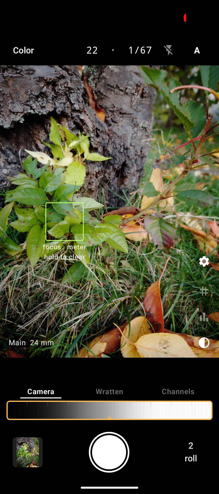
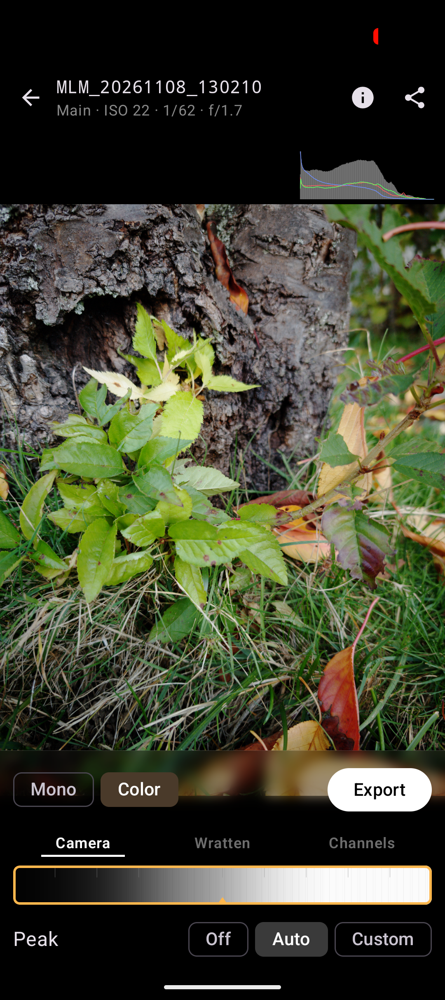

# Mimizan Lab Mobile

Mimizan Lab on the phone: a monochrome RAW camera and a darkroom, on
Android and on iOS. Both apps call the same Rust core as the desktop.
A frame is developed on the device into a monochrome negative, or into
a three-colour plate (Prokudin-Gorsky's principle, the desktop
darkroom's second process): three mixes through three taking filters,
the same paper, one RGB file.

**The first photographic application that takes the black-and-white
negative directly from the luma-chroma separation of the sensor signal
([Alleysson 2005](https://doi.org/10.1109/TIP.2004.841200),
[Dubois 2005](https://doi.org/10.1109/LSP.2005.859503)) without ever
reconstructing an RGB image — on the desktop, and now in your pocket.**

<p align="center">
  
  
</p>

**Not a filter that looks like film. A darkroom.** Other apps paint
scratches and light leaks over a phone photo. Mimizan Lab develops a
real negative on real paper. Nothing is pretended, because nothing has
to be.

**Never invents a pixel.** Every other camera guesses two of three
colours per pixel. Mimizan Lab reads the sensor the way analogue
television read its signal: luminance and colour separated, nothing
interpolated, nothing made up.

**You develop it. You don't edit it.** Two moves, grade and exposure,
and the picture answers. No curves, no masks, no sliders with numbers.
When it's done, it's done.

**Black and white like film.** Measured variable-contrast paper, soft
and hard light mixed like an enlarger. Highlights roll off the way
silver does.

**Colour the way it was first photographed.** Three separate colour
plates printed together. Saturated, deep, alive. No colour science
borrowed from a phone.

**See the print before you take it.** The viewfinder shows the paper,
not the camera's picture. What you see is what develops. (Android, and
the Pro iPhones with Apple Log.)

**Sharp without the halo.** Peak measures the negative and stops before
the edge becomes a line.

**Your pictures are yours.** No cloud. No AI. No account. Nothing
leaves the phone unless you send it.

**Buy it once.** The camera, the developer, Mono and Colour and the
print at half size are free. One purchase, no subscription, unlocks the
full-size print, the 16-bit TIFF and the negative for the desktop
darkroom. Shared with your family.

**From the phone you already carry.** Prints that stand next to a
medium-format negative, from your pocket.

Only finished pictures leave the app. The raw frame stays in the app
cache and can be developed again, or deleted there. Android writes no
DNG; the way to the desktop is Export. iOS keeps the captured DNG,
because that is the form AVFoundation hands over.

A short handbook for the phone and the desktop window:
[docs/HANDBOOK.md](https://github.com/Draganito/mimizan/blob/main/docs/HANDBOOK.md).
The phone runs the Mimizan separation only; AMaZE, RCD, DCB and LMMSE
stay on the desktop.

## Which phones

Android 13 or later, arm64, and a back camera that offers `RAW_SENSOR`
to other apps. No Google Play services. The phones that sell the most
keep RAW inside the maker's own camera: the Galaxy A series, the Moto
G and the cheap Redmi phones give this app no frame to develop.

Where RAW is available, the three big chip families have been checked
on one phone each. The chip decides how the finder is pinned to the
paper; the darkroom is the same everywhere.

| Chip | Checked on | Finder |
|---|---|---|
| Google Tensor (Pixel 6 and later) | Pixel 9, GrapheneOS, Android 17 | sRGB curve pinned; matches the paper. |
| Qualcomm Snapdragon | Pixel 4a | The camera's own curve stays (unless it offers an sRGB preset), the exposure stays put. Matches the paper in good light, leaves it in the dark. |
| Samsung Exynos | Galaxy S25 FE (SM-S731B) | sRGB curve pinned, like Tensor. |

On a Samsung phone, Exynos or Snapdragon, the RAW is already
lens-shaded, so the preview keeps that correction; without it the
finder is brighter in the middle than the print. A MediaTek phone that
offers RAW has not been checked.

The only fitted camera file is `cameras/google_pixel_9.json`. Another
phone still develops: the noise model and the colour weights stay the
core defaults until that phone has its own file. Sensor facts and the
device findings are in `docs/RESULTS_MOBILE.md`.

iPhone 12 and later on iOS 17, and the iPad Pro and iPad Air cameras
that offer Bayer RAW. An iPad without one can open the app but cannot
take a frame. The finder is the paper on the iPhones with Apple Log
(15 Pro and 15 Pro Max, 16 Pro and 16 Pro Max, 17 Pro and 17 Pro Max):
there the stream is the log frame, decoded to scene light and printed
through the paper as on Android. Apple keeps the log on the video
formats and offers the Bayer RAW under the photo preset alone, so the
shutter swaps the session for the still and back: the finder holds its
last frame for about a second while the finder's exposure is set in
the photo format and the RAW is taken. On the other iPhones and on the
iPad the finder is the camera's own picture, and the still is
immediate. The app asks the camera, not the model name. The swap is in
TestFlight first (see *Status*).

## Install

**Android.** Download `mimizan-lab-mobile-<version>.apk` from the
[releases page](https://github.com/Draganito/mimizan-lab-mobile/releases),
open it (allow installs from the browser or a file manager once) and
grant Camera, Notifications and, on Android 17, Sensors when asked. The
release build is signed with the debug key. Android will not update it
over a build with another key, so uninstall first when switching
between a release download and your own `installDebug`.

**iOS.** The app is on TestFlight; every `v*` tag uploads a build.

**Free and paid.** The APK from the releases page, the macOS app and
the Windows build are complete and free. The Play Store app and the App
Store app are free to use as well — camera, finder, developer, Mono
and Color, roll, 1:1 view and a JPEG at half the edge — and sell one thing once:
the print at full resolution, which is the full-size JPEG, the 16-bit
TIFF and the linear negative. The same product
(`ch.bojovic.mimizanlab.fullres`) on both stores; on Apple it is a
universal purchase shared with the Mac and with Family Sharing, and
Settings has Restore for a new phone.

## Using the app

The darkroom is the same on both phones. The finder is the paper where
the camera lets it be: on Android the preview is linearised, mixed with
the filter's channel weights and printed through the paper at the
standing exposures; on an iPhone with Apple Log the log frame is
decoded the same way. On the other iPhones and the iPad the finder is
the camera's own preview, desaturated in mono, untouched in colour.

1. **Finder.** Zebra marks the highlights and starts on; a histogram
   and a grid of thirds start off. The three are remembered. Tap sets
   focus and metering (the label under the box says so); a long press
   clears it. Flash cycles Off / Auto / On and fires on the still, not
   in the finder. A and M switch between the automatics and manual ISO
   and shutter; in M the line turns amber, the two sliders appear, and
   Auto flash does not fire. There is no EV slider: the automatics
   expose, and a print that came out dark is corrected in the
   developer, where the stops are what they say.
2. **Process and filter.** Mono or Color, kept across starts; Color is
   the three-colour plate. The taking filter is a row over the paper
   strip, under the finder (where the finder is the paper) and in the
   developer: in Mono the seven glasses (Pan, Y8, YG11, O16, R25, G58,
   B47), in Color the three ways to the plate, Camera (the sensor's
   colour matrix), Wratten (25/58/47) or Channels — the width shared in
   equal fields, the chosen one written in the glass's own colour with
   a line under it, a tap or a finger drawn along the row. The finder
   shows the standing filter, the next frame is mixed with it, and a
   change in the developer (a re-mix without developing again) becomes
   the standing one, as the process does. The frame remembers the
   choice in its `.grade` file beside the grade, so the roll says what
   it was last printed as. The colour
   space starts at sRGB; Adobe RGB is under *Color space* in Settings.
3. **Grade.** One strip, the paper itself: it is drawn from
   the core's paper table for the standing pair, over ten zones of
   linear grey with the grey card under the mark in the middle, so
   the strip shows what the paper does to the picture. One finger
   drags the exposure — both paper exposures move by the same stops,
   the ramp slides under the mark, the grade stays. Two fingers spread
   the grade — the ramp widens (softer) or closes (harder) around the
   middle, ±3 stops of hard against soft; zero is the paper's grade 2.
   A double tap is the base print, a second double tap on a strip
   already there brings the pair back. No label and no number: the
   picture is the reading. Behind
   the strip sit the same soft and hard exposures as on the desktop
   (±3 each, twelfths), written to the frame's `.grade` file
   unchanged: the strip only chooses the pair, the print is the same.
   The pair sits under the
   finder where the finder is the paper (Android, the Apple Log
   iPhones) and answers the drag: it is the standing grade, the paper
   finder, the automatic JPEG, and where a new frame starts, and the
   strip is the one exposure correction there is. Slider and strip are
   white at the base print and amber away from it, each for its own
   half: a grade set yesterday shows before the shot, and the double
   tap turns both white again. On the other iPhones and the iPad the
   finder is the camera's picture and nothing answers, so there is no
   pair under it and none in Settings: a new frame starts at the base
   print, and the paper is set in the developer, on the picture. The
   exposure line (process, ISO and shutter, flash, A/M) is the bar
   above the finder. Every frame keeps a grade of its own, stored
   beside it on the roll: moving a slider in the developer changes
   that picture alone, and the next shot starts from the standing
   grade again, not from the last correction.
4. **Peak** is Off or Auto in Settings where the finder is the paper,
   the standing choice for the automatic JPEG and a new frame; on the
   other iPhones and the iPad every frame starts at Auto and Settings
   does not ask. Auto measures radius and amount on each negative, Off
   leaves the exports unsharpened. In the developer a picture can also
   go to Off or Custom, which shows the two sliders and, like the
   grade, stays with that picture alone. The preview is never
   sharpened; the 1:1 view is.
5. **A shot** is JPEG, Developer or Raw. JPEG writes the picture at
   this grade and stays on the finder; it is the print the finder
   showed, so it is only offered where the finder is the paper. On the
   other iPhones and the iPad a shot is Developer or Raw. Developer
   opens the picture and the JPEG waits for Export. Raw keeps the
   frame on the roll and writes nothing until you open it. A fresh
   Android install starts on JPEG, a fresh iOS install on Developer.
   Every development is at full size; a small print is the same
   development on a smaller sheet, never a binned negative.
6. **The shutter** records one RAW frame into the cache and, in JPEG
   and Developer, develops it at once (on Android in a foreground
   service). The JPEG lands in `Pictures/Mimizan Lab` on Android, and
   in Files and, add-only, Photos on iOS.
7. **Review** opens from the thumbnail, or after a Developer shot.
   Pinch to zoom; past the 2048 px preview the window is rendered 1:1
   from the negative. The paper strip changes the preview,
   the histogram and every export, through the same paper. Export
   writes the JPEG, a 16-bit TIFF, or the linear negative plus
   saturation mask for the desktop (in Color the three-frame
   `.plate.tif`, which `mimizan print` prints in colour); on iOS also
   the DNG itself, the frame as the camera handed it over. In a store
   build without the purchase the JPEG is printed at half the edge,
   the same development on a smaller sheet, and the TIFFs and the DNG
   open the purchase instead. Share sends the last export, or the automatic
   JPEG of the frame.
8. **The roll** lists every frame in the cache (1.5 GB, newest first).
   The bin on Android, a swipe on iOS, or a long press on either
   deletes one. Exported pictures stay where they were written.
   Settings shows how much the frames take and can delete them all.

Only the most recent developed negative stays in memory (about 375 MB
with its preview planes at 12.5 MP; about 1 GB passes through while it
is separated). Import from Files and Photos is off on iOS: a
full-size NEF develops past what an iPad can keep in memory. The roll
is the camera's own frames.

## How it is built

```
Android   Camera2 RAW_SENSOR ──> RawInput (Kotlin) ──> mimizan-core (Rust, UniFFI)
iOS       AVFoundation Bayer RAW as DNG ──> develop_file (the desktop decoder)
both                     └─> app cache (re-developable)   └─> gallery or Files
                                                              MLM_*.jpg / .tif / .negative.tif
                                                              MLM_*_plate.jpg / .tif / .plate.tif
```

* `rust/mimizan-mobile` — the Rust library around `mimizan-core`:
  `develop`, `remix`, `preview`, `detail`, `export_*`, UniFFI for Kotlin
  and Swift. A cdylib for Android; a static library (plus `develop_file`
  / `frame_info` through the desktop's RAW decoder) for iOS.
* `android/` — Kotlin and Jetpack Compose (Camera2, a foreground
  service, review). Gradle runs `cargo ndk` and `uniffi-bindgen`.
* `ios/` — SwiftUI for iPhone and iPad (AVFoundation, a Metal
  viewfinder, the same darkroom and review). `scripts/build_ios.sh`
  builds the core into an xcframework.
* `cameras/google_pixel_9.json` — camera file (schema 1 of Mimizan
  Lab), shipped in the APK.
* `scripts/device_spike.sh` — timing and peak RSS on a phone.
* `docs/ARCHITECTURE.md`, `docs/RESULTS_MOBILE.md`.

The file path (`develop_file`, the DNG on iOS) and the buffer path
(`develop`, Camera2 on Android) give the same negative sample for sample
on a NEF (`tests/host.rs`, run where the desktop's `testdata` is
checked out; the CI runner has no such file and that test passes by
saying so). The Android negative matched the desktop CLI on a DNG of
the same frame to 0.015 % RMS.

### Build for Android

The Rust crate depends on `mimizan-core` as a git dependency pinned to
one commit of `Draganito/mimizan` (`rev` in `rust/mimizan-mobile/Cargo.toml`;
`mimizan-core.ref` carries the same hash for the workflows). So this
repository builds on its own — a TestFlight build, the GitHub APK and an
F-Droid build of the same version carry the same core (see
[Release](#release)).

```bash
git clone https://github.com/Draganito/mimizan-lab-mobile.git
```

To work on the core and the app at the same time, clone
`Draganito/mimizan` next to this repository and patch the dependency to
it in `rust/mimizan-mobile/.cargo/config.toml` (ignored by git):

```toml
[patch."https://github.com/Draganito/mimizan"]
mimizan-core = { path = "../../../mimizan/crates/mimizan-core" }
```

then `cargo update -p mimizan-core` once. Every cargo call — Gradle's
included — now builds against that checkout. Remove the file before a
release; `scripts/set_version.sh` refuses while it is there.

Prerequisites (user-local, no sudo):

* Rust stable with the target `aarch64-linux-android`, and `cargo-ndk`
  (`cargo install cargo-ndk`).
* Android SDK at `$ANDROID_HOME` (default `~/.local/opt/android-sdk`)
  with `platforms;android-37.1`, build-tools, and an NDK (the
  workflows use `ndk;27.3.13750724`; Gradle takes `ANDROID_NDK_HOME`,
  else the newest under `$ANDROID_HOME/ndk`).
* JDK 21.

```bash
cd android
./gradlew assembleGithubDebug  # cargo ndk -> uniffi-bindgen -> Kotlin -> APK
./gradlew installGithubDebug   # phone attached, USB debugging on
./gradlew assembleGithubRelease # a local release APK; the releases page is CI
./gradlew assemblePlayDebug    # the Play Store flavor, with Play Billing
```

Two product flavors share one source tree: `github` (everything owned,
no Play Billing in the APK) and `play` (Play Billing, the purchase).
Each provides `createEntitlements()` in `src/<flavor>/…/store/`.

`gradle.properties` sets `mimizan.rustProfile=release`, so a debug APK
still carries an optimised Rust library. `local.properties`
(`sdk.dir=...`) is git-ignored; create it or set `ANDROID_HOME`.
`build.gradle.kts` takes a release key from `android/keystore.properties`
(git-ignored; `storeFile`, `storePassword`, `keyAlias`, `keyPassword`)
when that file exists; today the releases carry the debug key.

Rust alone:

```bash
cd rust/mimizan-mobile
cargo test                        # synthetic frames
cargo test --features host-raw    # bit-for-bit against the desktop decoder (needs mimizan/testdata)
cargo ndk -t arm64-v8a --platform 33 build --release --lib
```

The `Android` workflow does the same on a Linux runner for a push that
touches `android/`, `rust/`, `cameras/` or `mimizan-core.ref`: cargo-ndk,
the bindings, the Kotlin unit tests, a debug APK as the artifact. A
`v*` or `android-*` tag starts `Android Release`, which builds the
minified APK and puts it on the release.

### Build for iOS

AVFoundation hands the Bayer RAW still over as a DNG
(`AVCapturePhoto.fileDataRepresentation()`). The app caches `<name>.dng`
plus `<name>.json`, and the core reads the file with the desktop decoder
(`develop_file`, the `decode-files` feature). The still is the size the
camera gives by default; a 14 Pro or later is not asked for its 48 MP
frame. The entitlement `com.apple.developer.kernel.increased-memory-limit`
is set. There is no foreground service: iOS grants a few seconds past
backgrounding, which is what one development takes.

A Mac with Xcode 26 builds it, or the `iOS` GitHub workflow, which
builds an unsigned `.app` on a macOS runner when a push touches `ios/`,
`rust/`, `cameras/` or `scripts/build_ios.sh`:

```bash
rustup target add aarch64-apple-ios aarch64-apple-ios-sim
scripts/build_ios.sh              # static libs, Swift bindings, ios/MimizanCore/MimizanMobileFFI.xcframework
brew install xcodegen
cd ios && xcodegen generate       # ios/MimizanLab.xcodeproj (not committed)
open MimizanLab.xcodeproj         # set your team; the simulator has no RAW camera
```

The Rust half of the script also runs on Linux (`--no-xcframework`).
The xcframework step needs `xcodebuild`. A free Apple ID signs for seven
days. The Developer Program signs for a year and for TestFlight and the
App Store. The unsigned CI artifact is for re-signing tools.

The `TestFlight` workflow runs on a `v*` tag, and by hand. The archive
is built unsigned. `xcodebuild -exportArchive` signs it with Apple's
cloud-managed distribution certificate through an App Store Connect API
key (Admin role). The repository secrets are `APPLE_TEAM_ID`,
`ASC_KEY_ID`, `ASC_ISSUER_ID` and `ASC_API_KEY_P8` (the `.p8`, base64).
App Store Connect needs an app record with the bundle id
`ch.bojovic.mimizanlab`.

### Release

One version number sits in three files: `versionName` and `versionCode`
in `android/app/build.gradle.kts`, `MARKETING_VERSION` in
`ios/project.yml`, and `version` in `rust/mimizan-mobile/Cargo.toml`
(what `version()` reports in the app). `scripts/set_version.sh <version>`
writes all three, raises `versionCode` by one, and pins the core: it puts
the `HEAD` of `../mimizan` into the `rev` of the Cargo dependency (and
`Cargo.lock`) and into `mimizan-core.ref`, and refuses when that
checkout has uncommitted core changes or a `HEAD` that is not on
`origin/main`, because cargo and the workflows fetch that commit. It
commits nothing.

```bash
scripts/set_version.sh 0.14.23
git commit -am "0.14.23: ..."
git push
gh release create v0.14.23 --title 0.14.23 --notes "..."
```

The `v*` tag starts `TestFlight` and `Android Release`. A tag
`android-<version>` publishes the APK alone and starts nothing on the
iOS side. The iOS build number is the workflow's run number, not the
`27` in `project.yml`; that one is for a local Xcode build.

**F-Droid.** F-Droid builds the `github` flavor from the same `v*`
tags on its own buildserver and signs it with its own key, so an
F-Droid install and a GitHub APK do not update each other. The recipe
is `metadata/ch.bojovic.mimizanlab.yml` in
[fdroiddata](https://gitlab.com/fdroid/fdroiddata); the copy kept here
is `docs/fdroid/ch.bojovic.mimizanlab.yml`. The buildserver (Debian
trixie) takes OpenJDK 21 and `rustup` from apt, the NDK the workflows
use from F-Droid's sdkmanager and Gradle from its transparency log;
Gradle drives cargo-ndk and the UniFFI generator as everywhere else.
The store text, icon, screenshots and the changelog per `versionCode`
are read from `fastlane/metadata/android/en-US` in this repository:
a release gets a `changelogs/<versionCode>.txt` there. Nothing else is
needed per release — F-Droid's update check reads the tag and
`build.gradle.kts`.

## Status

0.17.24 on Android and iOS: RAW capture, the finder as the paper
(Android, and iPhones with Apple Log), Mono and Color, the split-grade
paper, the zone strip and Peak with a print per frame, review with
remix and 1:1 detail, the exports, the roll. Checked on a Pixel 9 (main
and ultrawide), a Pixel 4a, a Galaxy S25 FE and, through TestFlight, an
iPhone 17 Pro (all three cameras). Every frame taken with the Apple Log
finder writes the stops between the finder and the developed negative
to `Files › Mimizan Lab › finder-match.json` (the median of the last
eight on that lens is what the finder applies; Settings shows it and
resets it). The first TestFlight round came back with the
camera's picture on Pro phones: Apple Log and the Bayer RAW still
very likely live on different formats of the same camera. 0.16.2 says
in Settings › Viewfinder which step decided it, writes every format
of the lens to `formats.json` beside the match file, and shares both
files from there. The first `formats.json` from an iPhone 16 Pro
(iOS 26.6) answered it: eight Apple Log formats, every one in 10-bit
4:2:2 (`x422`), none in the 4:2:0 the app insisted on, and among them
1920×1440 at 30 fps with a 4032×3024 still. 0.17.1 accepted 4:2:2, and
the second file said the rest: with the Log format active the camera
offers no RAW type at all (`logRawTypes: []`). 0.17.2/0.17.3 keep the finder
in the Log format and swap the camera to the photo format for the
still with the exposure the finder stood at, and swap back. The third
file, from an iPhone 17 Pro on iOS 27.0, said why that could not work:
the same 4032×3024 format offers no RAW type when set by hand and
`bgg4` under the `.photo` preset, so the empty list in the second file
was about `.inputPriority`, not about the Log format (AVFoundation has
offered Bayer RAW under the photo preset alone since 2016). 0.17.10
swaps the session's preset at the shutter, not the format. 0.17.12
commits the photo preset before reading the RAW type, catches the
NSException AVFoundation raises instead of aborting, and if the Log
session will not start falls back to the camera's picture; the
histogram of a Log frame stays inside the buffer. The Settings note
reads "Apple Log for the finder; the Bayer RAW still (bgg4) comes from
the photo preset, 4032×3024, the session switched at the shutter". The 17 Pro also lists three `btp2` Apple-Log-only video
formats (4224×2240, 4224×3024; the ProRes RAW ones) and a colour space
the iOS 26 SDK has no name for (`4`); neither is used. 0.17.13 to
0.17.18 made the swap and the return work on the device: the running
Log session cannot be put on the photo preset in place, and a photo
output that has been through the Log keeps an empty RAW list, so the
still rebuilds the graph the lens opened with (input and fresh outputs
under `.photo`, the device back to sRGB at its own frame rate), reads
the RAW type after the commit, shoots, and rebuilds the Log finder;
opening the lens again after the developer or the background does the
same, since the three things a Log finder leaves behind — the device's
colour space and 30 fps lock, a session left on `.inputPriority`, a
video output still asking for the 10-bit subtype — each made the next
`addInput`/`addOutput` raise "Unsupported format ((null))" and abort
(now caught and said in the finder). The first twenty frames from the
17 Pro put the match at −0.7 to −1.1 stops on all three cameras, the
ultra-wide half a stop below the main; 0.17.19 keeps the match per
lens, a lens not yet measured starting from the other lenses' pool.
0.17.4 to 0.17.9
settle the camera screen: the grade as one slider
over the zone strip (the same soft and hard behind it, the same
print), the exposure line as a bar above the finder, the finder's
buttons along its lower edge, slider and strip amber when they are off
the base print, the pair, the JPEG shot and the standing Peak only
under a paper finder (every other frame starts at the base print and
Auto), no binned quick development, and the colour process called
Color wherever the user reads it. 0.17.0 adds the store builds' one purchase (the
print at full resolution) through StoreKit 2 and Play Billing; the
product has to exist in App Store Connect and the Play Console before
the Unlock button can show a price. Open: the Pro-iPhone question, the
measurement, a fitted camera file for any phone but the Pixel 9, and a
MediaTek phone.

## License

Copyright (C) 2026 Dragan Bojovic.

Mimizan Lab Mobile is free software under the GNU General Public License,
version 3 or any later version. See [LICENSE](LICENSE). The APK ships that
text and a short notice in its assets. The iOS App Store build does not:
that copy keeps the copyright line and leaves this license out of the
bundle. Releases published before this change stay under the MIT license
they were shipped with.
